# 2. 方法设计

## 2.1 方法概述

Agent 推理服务需要在多个 Program 之间分配执行机会，同时决定哪些 KV 状态值得跨过工具等待继续保留。过早释放状态，会增加续轮的恢复、重算和重新排队开销；过度保留状态，则会压缩其他调用的准入空间，并加剧运行中的容量竞争。随着多轮上下文增长，执行顺序、缓存驻留和跨层传输逐渐成为相互影响的系统决策。

Kairos 面向这一联合问题，以降低平均 Program 完成时间（JCT）为目标。它从已到达的输入、已完成调用和当前 KV 布局中提取因果信息：一个概率森林估计当前调用的输出规模，另一个分布森林估计当前调用之后的剩余服务量；对就绪调用，Kairos 用“预期任务推进比例 / 当前物理服务代价”构造统一排序指标。排序负责说明先服务谁，独立的容量事务负责检查哪些调用现在确实能进入，并只回收不再被运行态或 DMA 引用的可撤销 KV。

工具等待期间，Kairos 将缓存保护建模为一项有限期限的选择：保护可能减少返轮时的恢复成本，但也会占用其他就绪调用可以使用的 HBM。系统用实际可恢复布局估算保留收益，用当前容量计划的成对比较近似资源压力，再结合已观测工具返回间隔选择保护期限。GPU 与 CPU 缓存则按联合可恢复前缀管理，避免只看单块命中或重复副本而破坏整段恢复路径。

方法由信息感知、程序调度、KV 连续性管理和跨层恢复执行四层组成。它们依次完成“观测因果历史—形成概率报价—排序并作容量授权—保留或恢复真实状态”，使预测的不确定性、当前执行机会和跨轮缓存价值各自在明确的决策边界内发挥作用。

## 2.2 现有挑战

### 2.2.1 从独立调用到具有状态的多轮 Program

与以单次生成作为服务完成边界的请求相比，Agent 任务通常表现为 LLM 调用、工具执行、结果反馈和下一轮调用的交替过程。某次响应结束意味着一个推理阶段完成，整个任务则继续沿后续调用推进。多个 Program 的调用在同一引擎中交错，历史上下文可能持续增长，并在后续轮次反复复用。

这种执行结构带来三个后果。首先，各轮请求具有依赖关系：当前调用更早完成，会提前启动工具，并改变后继请求出现的时刻。其次，工具执行暂时停止 GPU 推理，同时保留历史 KV 的未来价值，形成“当前等待工具、状态仍值得保留”的阶段。最后，每轮重新排队、恢复和重算的开销会沿 Program 累积，端到端任务体验由整个调用序列共同决定。

Autellix 已将 Program 作为调度对象，并利用累计已获服务量协调多轮调用。Continuum 进一步将工具期 KV 保留与返轮排队联系起来，指出 CPU offload 之外仍存在 GPU 容量等待。MARS 与 MORI 分别从异构资源压力和多层状态驻留推进了这一方向。[1–4]

因此，面向 Agent 的推理服务需要同时理解调用之间的程序依赖、工具引起的阶段切换，以及历史状态对后续执行的作用，并以 Program 的完成过程组织调度与资源管理。

### 2.2.2 执行机会与跨轮状态保留相互制约

保留工具期 KV 能减少返轮恢复和重算；若保留策略同时维持容量或优先资格，还可能减少返轮的重新准入等待。回收 KV 则能释放 HBM，允许其他就绪调用进入，或支持已运行调用继续增长。状态未来越有用，保留越有价值；当前竞争越强、保留真正挡住的执行机会越多，回收越有价值。

这是一种有限容量下的机会成本权衡。缓存驻留时间需要同时匹配未来复用和当前竞争。相同大小的缓存、相同的预计工具时长，在不同竞争者和资源状态下，可以对应不同的合理处理。工具尚在执行时的保护，与返回后获得实际执行承诺，是两个相关而各有边界的决定。

Continuum 以经验工具返回累积分布函数（CDF）估计保护期限（TTL）内的复用概率，将 prefill/reload 和乱序排队收益与 GPU 占用成本比较，并优先处理 TTL 内保留的返轮。MARS 根据实时 GPU/CPU 压力调节准入，结合反馈优先级、增量 prefill 和机会式状态回收，其工具期保留同样权衡 warm resume 与占用成本。MORI 则以近期推理和工具时间的相对比例刻画空闲程度，让更忙的 Program 驻留 GPU、较空闲的 Program 驻留 CPU，并按容量调整边界。[2–4]

这些方法已经认识到调度与驻留相互影响。进一步需要研究的是：当 Program 的剩余工作、当前调用大小、返回阶段和恢复代价各不相同时，如何利用这些差异分配推进机会，并使排序、容量授权与跨轮保护形成稳定配合。Kairos 从任务推进价值和本次执行代价两个角度组织这项决策。

本地 SWE 回放提供了与这一目标相对应的端到端观察：在 Dense 到达下，Kairos 的平均 Program JCT 为 85.14 s，低于 Continuum 的 105.12 s 和原生 vLLM+LMCache 的 128.48 s；在 Poisson JPS=1/2 下，Kairos 分别为 80.02/83.44 s，Continuum 为 85.35/97.50 s。该结果与“在状态保留和当前执行机会之间联合权衡”的设计动机一致，但每个方法与负载组合只运行一次，且比较的是异步与同步执行路径不同的集成系统，不能据此把收益单独归因于排序、准入或 TTL 中的某一个环节。完整均值图和实验限制见第 2.3.6 节。

### 2.2.3 Offload 同时改变 GPU 容量、CPU 状态和未来恢复路径

Offload 将 GPU 状态迁移到 CPU，其潜在收益包括释放 HBM 以服务当前竞争者，以及为未来返轮保留可回载的历史，减少从头重算。前者取决于真实释放的容量能否带来执行机会，后者取决于数据的再次复用及其替代的重建成本。

KV 块的价值具有位置和复用差异。AsymCache 将复用可能性与位置相关的重算成本结合，并通过 Multi-Segment Attention（MSA）支持非连续缓存片段。因此，相同大小的两个块可能具有不同的保留收益。这种位置差异主要体现在避免的重算量；等大小块的纯传输成本主要由数据量决定。[5]

Offload 也需要付出资源代价。D2H/H2D 消耗链路、内存带宽和队列资源，备份完成之前通常还需要保留 GPU 源页；传输与工具等待或计算的重叠程度，决定其关键路径代价。有效 CPU 副本的复用还关系到重复存储和重复传输。

更重要的是，CPU 容量有限。接纳新备份可能需要挤出其他 Program 的状态，也可以采用部分接纳。一次 GPU 回收决策由此可能把恢复代价转移给另一个 Program。MORI 显式约束 GPU 与 CPU 两层容量，并通过层级分配及迁移黏性减少反复搬运；AsymCache 则指出，多层存储中的传输与重算具有不同成本结构，需要相应的层级判断。[4,5]

因此，offload 应围绕完整布局转换评价：何时释放多少可用 HBM，付出什么传输和 CPU 替换代价，以及转换后哪些恢复路径仍然成立。共享页、重复副本、前缀缺口和 CPU 接续关系，使缓存收益依赖块之间的组合。在连续前缀恢复后端中，后续片段的使用依赖其之前历史的完整接续。

### 2.2.4 有价值的未来信息有限、带不确定性，并随执行更新

调度需要未来信息，而 Agent 的后续过程持续受到运行结果影响。当前输出何时结束取决于生成过程；工具耗时受到参数、输入规模、运行环境与外部服务影响；后续调用次数和工作量则可能因成功、失败、重试或重新规划发生变化。新 Program 通常缺乏个体历史，相似的当前输入也可能产生差异显著的后续轨迹。

现有方法形成了不同的信息使用路线。Autellix/PLAS 使用累计已获服务量协调多轮调用；TIE 预测当前请求的输出长度分布，并用尾部信息修正 SJF 风格排序；Continuum 使用工具类别的经验返回分布决定 TTL；MORI 利用近期阶段比例估计 Program 的忙闲状态；UniBoost 利用已获服务量等信号塑造优先级，并控制有 KV 代价的抢占。[1,2,4,6,7]

这些方法分别面向当前输出长度、下一次工具返回、近期忙闲阶段或已获服务量。整个 Program 的剩余工作又是另一种信息：它描述任务距离完成还需要多少后续推理。信息层需要选择能够以合理成本获得、又能直接影响当前执行或驻留选择的预测对象。

未来信息具有直接价值。当前服务量有助于减少短调用等待；返回分布有助于判断保留是否赶得上下次复用；剩余工作信息有助于识别接近完成的任务。将这些信息转化为完成时间收益，还需要控制器同时保留真实的工具阶段、执行组织和资源后果。

因此，信息层应以当前可观测事实为基础，提供低成本、可更新并显式保留不确定性的条件估计；控制层则依据任务阶段和真实资源状态消费这些信息。Kairos 采用因果历史上的后缀服务量分布和工具返回经验分布，并分别验证信息质量及其端到端效果。

### 2.2.5 工作负载跨度、状态复用与可观测信号

**调用跨度。** 为说明上述挑战在本地数据中的量级，图 1 对 SWE 的自然完成 Program 与 GitHub Copilot 有界 user-turn 记录作了描述。SWE-36 的每个自然完成 Program 中位数包含 10 次 LLM 调用，P90 为 18 次，最多 24 次；Copilot 测试集的 1,241 个 user-turn 中，76.8% 只有一次调用，中位数为 1、P90 为 2。两者任务终点定义不同：Copilot 记录只覆盖有界 user-turn，不能视为经验证的自主 Agent 任务完成轨迹，因此这里比较的是记录调用跨度，而不是同一总体上的完成轮数。后者还经过记录边界提取，排除了超过 30 s 的调用间隔，不能据此判断真实 Copilot 任务通常只需一轮。

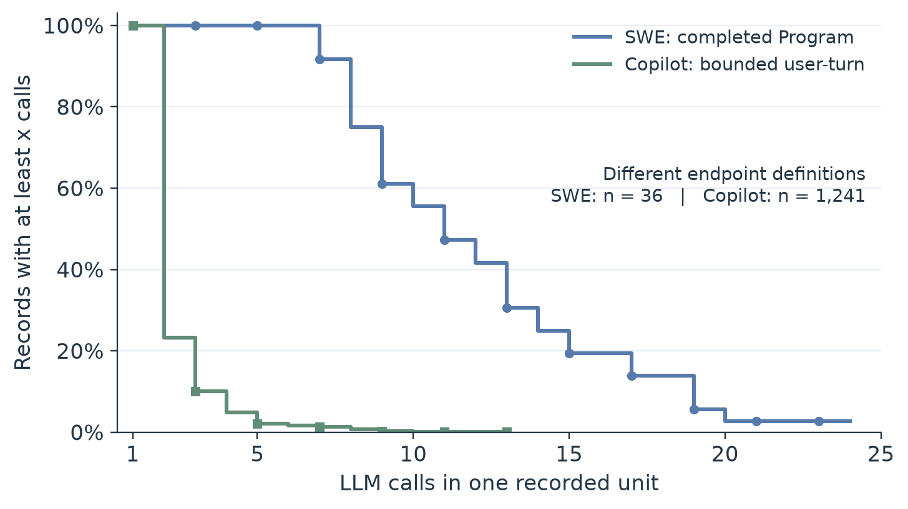

图 1：至少包含 $x$ 次调用的记录比例。SWE 中，多轮状态的管理影响整个任务；Copilot 有界记录则包含更高比例的单调用。两者终点定义不同，曲线用于说明观测跨度差异，不是同类任务难度的直接比较。 [PDF](./figures/workload/call_span.pdf)

**等待长尾。** 工具等待并非固定时长。SWE 中仅 20 个具备有效工具时间戳的 Program 提供了 185 个正间隔样本；中位数为 0.182 s、P95 为 0.764 s，最大值为 22.56 s。按时长降序取最慢的 10 个间隔，即约 5% 的样本，已经贡献 50.4% 的累计间隔时间。我们另对 TraceLab 未缩放的原始记录统计：43 位匿名用户的 357,161 轮记录包含 431,905 个有效非负工具 wall-latency 样本，其中位数为 0.196 s、P95 为 30.009 s，最慢约 5% 贡献 88.9% 的累计记录时长。

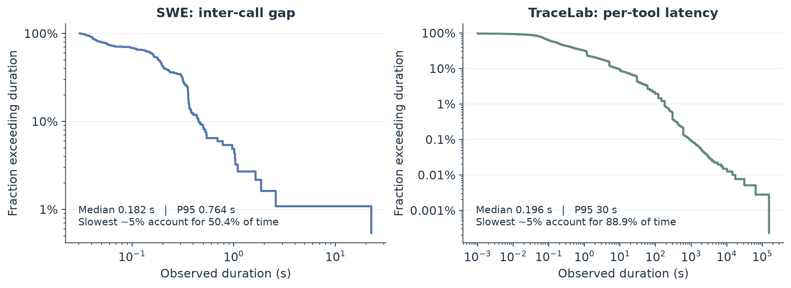

图 2：两种观测口径分别展示的时长生存曲线，横纵轴均为对数。左图是 SWE 的调用间工具返回间隔；右图以原始样本的经验分位点绘制 TraceLab 单个工具的记录 wall latency，包含等待和运行环境影响，不能等同于纯工具计算时间或 Program 的连续空闲窗口。右图仅在正时长处绘线，比例的分母仍为全部有效时长样本；图中的累计时长是样本时长之和，不是整个数据集的墙钟运行时间。此处沿用 CONTINUUM 图 5 用长尾和累计时间份额说明等待不确定性的分析方式。[2] [PDF](./figures/workload/tool_wait_tail.pdf)

这些观测支持将工具期保护视为有期限的选择：多数短等待可能很快复用状态，少量长等待则可能长期占用 HBM。它们并不直接给出最优 TTL；具体保护还应结合当前竞争和恢复代价。SWE 的有效时间戳样本有限，TraceLab 又来自志愿用户记录，不能断言所有 Agent 工作负载具有相同分布，也不把两条不同口径的曲线用于比较工具执行速度。

**上下文增长与跨轮复用。** SWE-36 从首轮到末轮的 prompt 长度中位数由 1,414.5 增至 6,188 token；365 个返轮调用中，与紧邻历史逐 token 相同的可复用前缀占当前输入的中位比例为 93.0%。图 3 将输入增长与前缀占比并列：调用越往后，管理的状态可能越大，而返轮输入的大部分又来自历史。这说明工具期回收影响的是可再次使用的大段上下文，单独优化当前输入的新 token 数不足以描述续轮代价。

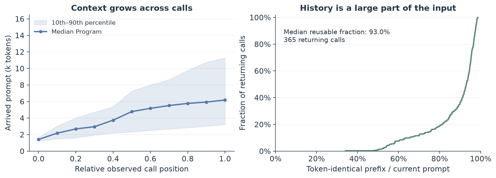

图 3：左图按每个 Program 已记录的调用位置离线对齐，绘制 prompt 长度的中位数与 10%–90% 分位带；首尾分别对应各 Program 的首次和末次调用。右图为返轮调用的 token 相同前缀占比 CDF，描述潜在可复用内容，不是 GPU 实际命中率。相对调用位置只用于事后对齐，不作为在线可见的完成进度输入。 [PDF](./figures/workload/context_reuse.pdf)

TraceLab 原始数据也含大量历史前缀，但适用域差异很大：有效正输入的中位长度为 124,024 token，显著超过当前 16K 实验上下文。其 provider-prefix 计数还表示服务端已实现的缓存记账，不能替代逐 token 的相同前缀证明。因此，这里只用原始 TraceLab 描述工具长尾与上下文规模，不用经过类别抽样、输入缩放的回放子集代表原始分布，也不声称当前森林已在这些长上下文记录上验证泛化。

**已执行轮数不等于剩余工作。** 图 4 直接观察 SWE 中本轮之后还需完成的标准服务量。已完成 4 次调用的 36 个 Program，剩余服务的 10%–90% 分位范围仍为 1.70–21.76 reference s；在已完成 8 次调用时，对仍有当前调用的 22 个 Program，该范围为 1.80–17.05 reference s。相同的已执行轮数对应不同的未来工作，固定地把“执行更久”解释为“更接近结束”会丢失这种差异。

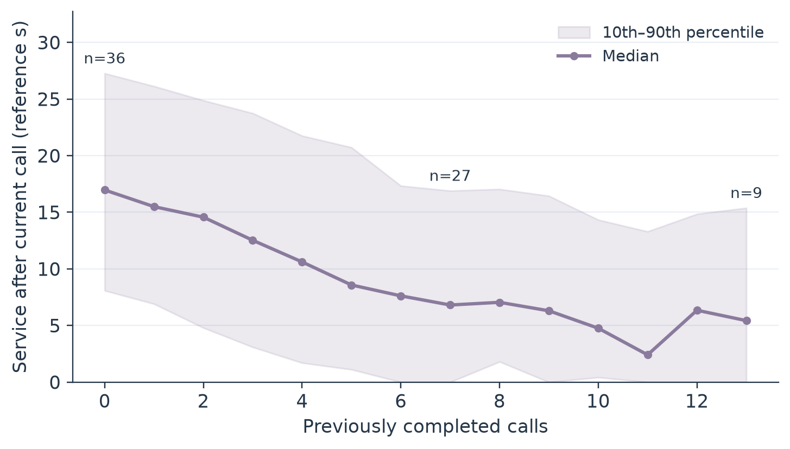

图 4：每个调用阶段的后续服务中位数与 10%–90% 分位带，保留本轮即结束的零后缀标签。只绘出仍有至少 8 个 Program 的阶段，并标出部分样本数。曲线后段来自尚有调用的存活子集；中位数局部回升体现样本组成变化，不代表同一个 Program 的剩余工作增加。所有真值仅用于离线描述。 [PDF](./figures/workload/residual_by_stage.pdf)

初轮预测还受到单个可见字段解释能力有限的约束。我们在 SWE-36 的 36 个留出 Program 上，仅取首次调用状态，计算 prompt 可见字段与事后剩余服务标签的 Spearman 相关，并以 Program 为单位做 2,000 次 bootstrap。下表中点估计的绝对值均不超过 0.33，95% 区间均覆盖零。该小样本分析不代表森林特征重要性，也不证明组合特征无效；它提示单一初轮字段不足以稳定描述未来工作，为使用多维历史并保留预测分布提供动机。

| 初轮可见字段 | Spearman 相关 | 95% bootstrap 区间 |
|---|---:|---:|
| Prompt 长度（log token） | -0.192 | [-0.536, 0.188] |
| Issue 文本长度（log 字符） | -0.321 | [-0.642, 0.041] |
| Issue 文本行数（log 行） | -0.078 | [-0.425, 0.291] |
| Issue 代码占比 | 0.071 | [-0.267, 0.395] |
| Issue 错误词数（log 计数） | -0.152 | [-0.475, 0.234] |

这些统计分别回答“记录跨几轮”“等待多久”“历史有多大且能复用多少”“已知阶段还能否区分剩余工作”，并对应程序级调度、有限保护、布局感知恢复与分布预测的设计需求。它们用于说明工作负载特征，不代替第 2.3.6 节对集成系统的端到端评价。

## 2.3 Kairos 方法设计

### 2.3.1 目标、对象与总体结构

**服务对象。** Kairos 面向多个串行多轮 Program 共享单 GPU 推理引擎的场景。一个 Program 在任一时刻至多有一个当前调用；调用完成后，Program 可能进入工具等待，随后再提交下一轮。不同 Program 的调用可以同时排队、运行或处于工具期。记 Program $i$ 的到达时刻为 $A_i$、完成时刻为 $C_i$，尚未完成的 Program 数为 $N_u(t)$。优化目标是平均 Program JCT：

$$
\min_{\pi}\;\mathcal{J}(\pi)
=\frac{1}{N}\,\mathbb{E}_{\pi}\!\left[\sum_{i=1}^{N}(C_i-A_i)\right]
=\frac{1}{N}\,\mathbb{E}_{\pi}\!\left[\int_0^{\infty}N_u(t)\,dt\right].
\tag{1}
$$

后一种表达说明，缩短某个调用只有在它确实提前推动一个未完成 Program、并减少系统中未完成任务的时间面积时才有价值。Kairos 因而不把单次请求吞吐、缓存命中或释放页数直接当作最终目标，而是将它们视为影响 Program 推进的中间因素。

**四层职责。**

| 层次 | 回答的问题 | 主要输出 |
|---|---|---|
| 信息感知 | 当前调用和当前调用之后还可能有多少服务工作？工具大约何时返回？ | 当前输出分布、后缀服务分布、工具返回经验分布 |
| 程序调度 | 哪个已就绪调用最值得先服务？当前资源能否兑现该选择？ | 单一就绪队列、调用级容量授权、受保护容量账本 |
| KV 连续性管理 | 工具期历史值得保护多久？占用当前容量的机会成本多大？ | 有限保护期限、可撤销引用、必要 victim 集合 |
| 跨层恢复执行 | HBM 与 CPU 中的实际布局能否接续？释放或回载后怎样安全推进？ | 可恢复前缀、传输/重算路径、原生分配和完成事件 |

这四层不是四个独立排序器。信息层给出概率报价；调度层产生一个供就绪请求使用的次序和一个供资源回收使用的连续性次序；容量事务决定哪些调用能获得名额；缓存层按真实引用和覆盖关系落实动作。预测不能越过容量授权直接分配内存，缓存命中也不能代替对 Program 推进的判断。

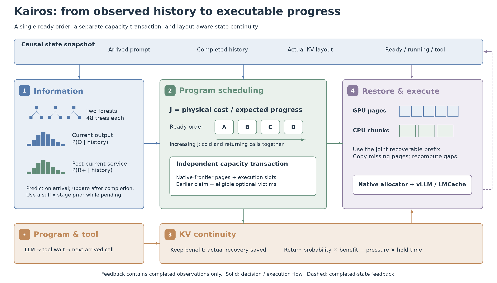

图 5：Kairos 的总体结构。上方只读快照连接信息、调度与执行；两个森林提供当前输出和后续服务的分布，统一 ready 顺序经容量事务转为真实执行机会。下方连续性管理结合工具返回与恢复收益选择保护期限，实际分配和传输仍由原生执行侧落实。虚线表示完成事件更新观测历史，而非向预测器提供未来标签。 [PDF](./figures/method/architecture.pdf) · [可编辑 PPTX，幻灯片 1](./figures/method/Kairos_Method_Figures.pptx)

本文统一使用以下符号。标准服务秒用于刻画任务本身的参考工作量；物理服务秒用于依据当前设备标定和实际 KV 布局估算执行代价，两者通过独立标定关联，不能不加区分地相加。

| 符号 | 含义 |
|---|---|
| $n_i$、$k_i$ | 当前 prompt 长度、已确认可复用的历史前缀长度（token） |
| $O_i$、$\widehat{O}_i$ | 当前调用输出长度随机变量及其条件预测均值（token） |
| $s_i$ | 当前完整调用的标准服务量（参考秒） |
| $R_i^+$ | 当前调用之后，Program 后续调用的总标准服务量随机变量（参考秒） |
| $t_i$ | 当前 KV 布局下完成当前调用的物理服务报价（标定秒） |
| $g_i$ | 完成当前调用所代表的预期 Program 工作推进比例 |
| $J_i$ | 单位预期推进比例所需的物理代价，$J_i=t_i/g_i$ |
| $G_i,H_i^{\mathrm{CPU}},E_i$ | 已确认 GPU 前缀、CPU 接续区间及两者形成的联合恢复端点 |
| $M_i$、$r_i$ | 当前调用所需页数、该 Program 已计入账本的页数 |
| $L$ | 去掉固定安全余量后的准入页数上限 |
| $D_z$ | 工具类别 $z$ 的历史返回间隔随机变量 |
| $B_i$、$\rho_i$ | 保护 KV 所减少的恢复代价、当前容量压力率近似 |

### 2.3.2 信息感知层：两个预测对象和一条因果边界

**森林如何形成分布。** 两个预测器都是浅层树集成：每棵树依因果特征把样本划入叶节点，叶节点保留训练样本目标的经验分布；线上遍历各树并平均叶分布，而非只平均一个点值。结构为 48 棵树、最大深度 7、叶样本下限 24、特征子采样比例 0.8，随机种子固定为 20261020；每棵后缀树的结构样本与分布估计样本按 Program 身份隔离。后缀服务森林使用 127 维已观测前缀特征，在当前 16K 适用域中以 157 个完整训练 Program 训练；当前输出森林使用对应的到达输入、已完成输出和已完成服务特征，同样保留输出样本分布。若当前输出的可见消息缺失，使用按可用因果字段训练的元数据输出模型；若后缀预测缺少可见消息或尚未就绪，则使用阶段条件的训练服务先验，不因缺少输入而读取未来信息。

**当前调用输出。** 当前请求到达后，森林根据已到达的 prompt、可见消息和已完成调用历史，对本轮输出长度建立分布 $P_i^O(o)$。分布随后按已经生成的 token 数 $g_i^{\mathrm{obs}}$ 和公开输出上限 $u_i$ 做条件化与截断，形成当前可用分布：

$$
\widetilde{P}_i^O(o)=P_i^O\!\left(\min(O_i,u_i)=o\mid \min(O_i,u_i)>g_i^{\mathrm{obs}},\ x_i,H_i\right),
\qquad
\widehat{O}_i=\sum_o o\,\widetilde{P}_i^O(o).
\tag{2}
$$

其中 $x_i$ 是当前已到达输入，$H_i$ 仅含此前已经完成并观测到的历史。公开上限只描述请求允许的边界，不是当前输出的真值，也不作为预测标签。若当前输出分布在生成过程中已被观察到 $g_i^{\mathrm{obs}}=u_i$，其预测剩余输出为零；否则按式中存活分布归一化。

森林给出完整输出分布，但当前服务报价用条件均值 $\widehat O_i$ 进入经标定的服务函数：

$$
s_i=\mathcal{S}(n_i,\widehat O_i,k_i).
\tag{3}
$$

$\mathcal{S}$ 使用输入长度、输出长度、已确认的共享前缀和服务 profile 将工作换算为标准服务秒。这里的 $s_i$ 是当前调用的参考工作量，不是输出长度本身；它也不意味着调度器知道本轮最终会生成多少 token。

**当前调用之后的剩余服务。** 第二个森林针对 $R_i^+$ 建模，输出离散分布 $\widehat P_i^+(r)$，由原子 $r_{ij}$ 与概率质量 $p_{ij}$ 表示：

$$
\widehat P_i^+(r)=\sum_j p_{ij}\,\delta(r-r_{ij}),
\qquad \sum_jp_{ij}=1.
\tag{4}
$$

$R_i^+$ 从当前调用之后开始，表示后续 Program 服务量；它不是当前输出长度，也不是某一条完整未来轨迹。森林使用到达时已经可见的消息、prompt 长度、已完成输出长度及已观测服务量形成因果特征。预测模型与评估 Program 身份隔离；新预测只在请求到达或历史完成后更新，不读取未来 prompt、未来工具类别/耗时、最终调用轮数或结束标记。

**异步预测与历史更新。** 当前输出森林在当前请求到达时，依据此刻可见输入形成本轮输出分布；后缀服务森林由单写者后台任务构造特征并遍历。若后缀个体预测尚未就绪，阶段先验立即提供相同格式的 $R_i^+$ 分布；个体预测到达后，在下一次调度快照替换先验报价。一次调用完成后，真实输出 token 数与实际服务量才转为已观测历史，用于之后的请求。该因果顺序既允许输出固定工作量 Replay，也不把 Replay 的停止标签泄漏到当前决策。

工具返回时长使用工具类别的经验分布。新样本只在相应工具实际返回后加入历史；未发生的返回不由调度器模拟或预知。工具返回分布只用于工具期保护期限，不代替当前调用的工作量预测。

**预测器离线评价。** 我们将随代码发布的两个森林单独取出，在本地 CPU 上重算留出 Program 的调用前预测，不运行调度器，也不改变模型。SWE-36 含 36 个自然完成 Program、401 个调用前状态；SWE-14 含 14 个 Program、161 个状态。两组身份均与当前模型训练身份隔离，但它们已经用于历史研究评价，不能称为新获取的盲测。图 6–9 只比较当前 Kairos 预测与真实观测，分别检查点误差、区间校准和具体任务上的分布变化。

| 留出集合 | 预测对象 | MAE ↓ | CRPS ↓ | 90% 区间覆盖率 | 平均区间宽度 | 预测落在真实值 0.5–2 倍内 |
|---|---|---:|---:|---:|---:|---:|
| SWE-36，36 Program / 401 状态 | 当前输出（token） | 55.34 | 38.35 | 93.35% | 253.92 | 84.06% |
| SWE-14，14 Program / 161 状态 | 当前输出（token） | 60.21 | 42.05 | 91.91% | 262.41 | 82.08% |
| SWE-36，36 Program / 401 状态 | 后续服务 $R^+$（reference s） | 5.92 | 3.69 | 97.13% | 29.84 | 55.10% |
| SWE-14，14 Program / 161 状态 | 后续服务 $R^+$（reference s） | 4.69 | 3.04 | 99.49% | 31.18 | 71.54% |

表中先在每个 Program 内平均，再对 Program 等权，避免长任务因调用更多而支配汇总。两倍范围指标仅在真实值大于零的状态上计算；真实后缀为零时，倍数误差没有合适分母，但这些状态仍参与 MAE、CRPS 和覆盖率评价。当前输出使用 token 单位，后续服务使用冻结参考 profile 的标准服务秒，二者不能直接比较数值大小。当前输出误差换算到当前服务 $s$ 的 MAE 分别为 0.617/0.671 reference s；这是同一输出误差经参考 decode 系数换算的结果，不是另一项服务器时延测量。

MAE 是预测均值与实际值之差的绝对值平均。例如实际输出 100 token、预测 140 token，该次误差为 40 token；“MAE 为 55.34 token”不表示每次都误差 55，也不表示 55% 的预测正确。CRPS 则同时评价整个预测分布与实际值的距离，单位与目标相同，越低越好；它会惩罚概率质量放在远离实际值的位置，不是一个百分比准确率。

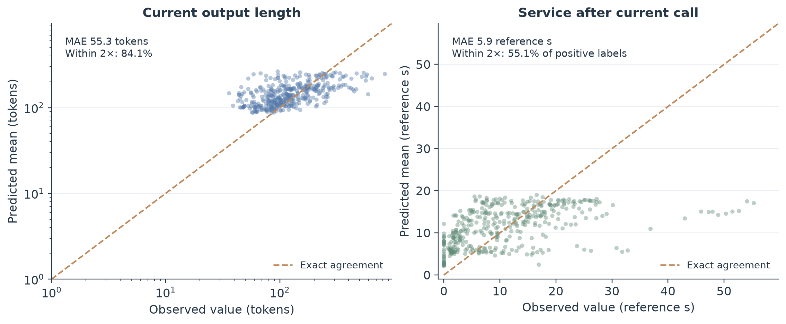

图 6：SWE-36 的调用前点预测，每个点对应一个状态，横轴为实际值，纵轴为预测均值，虚线为完全一致。左图用对数坐标保留输出跨度；右图保留零后缀。接近对角线表示点误差较小，偏离则揭示误差方向。可见后续服务预测仍有向总体均值收缩的现象：短后缀被高估，较长后缀被低估。因此这里不把区间高覆盖率称为高精度点预测。图中点等权显示，标注指标采用 Program 等权。 [PDF](./figures/prediction/observed_vs_predicted.pdf)

**覆盖率回答的是区间是否包含实际值。** 对每个状态取预测分布的第 5 和第 95 百分位，得到名义 90% 的中央预测区间。若该区间为 $[63,255]$ token，实际输出 93 token，则本次被覆盖；实际输出 300 token，则未被覆盖。对许多状态统计这个事件的频率，才得到经验覆盖率。它不是“预测正确的概率”，也不是均值估计的置信区间。

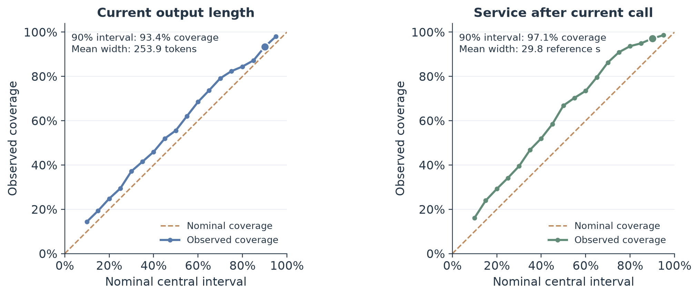

图 7：不同名义中央区间在 SWE-36 上的实际覆盖率，虚线为名义值，圆点强调名义 90% 区间。曲线在虚线上方表示覆盖偏保守；离散分布及零值质量也会影响覆盖率。图中同时标注平均区间宽度，避免把过宽的区间误认为精确预测。这里不使用均值的置信区间来代替单状态的预测区间。 [PDF](./figures/prediction/interval_calibration.pdf)

SWE-36 的 $R^+$ 区间按 Program 等权覆盖率为 97.13%；若直接计数全部调用前状态，则为 381/401，即 95.01%。前者先让每个任务获得相同权重，后者让每次调用获得相同权重，因而不应把 97.13% 写成“401 次中有 97.13% 被覆盖”。对应的平均区间宽度为 29.84 reference s，说明分布仍较宽；名义 90% 实际覆盖约 97% 是保守性表现，不足以单独证明预测器优秀。当前输出区间更接近名义覆盖，但其宽度同样需要与具体输出规模一起理解。

**从一个任务看分布如何更新。** 为避免挑选预测最好的示例，我们按 SWE-36 的“调用数、Program ID”排序，固定取下中位任务 `psf__requests-1766`，共 10 次调用；再取其下中位调用，即第 5 次。图 8 展示整个任务的后续服务轨迹，图 9 展示同一次调用的两个预测分布。该选择只依据轨迹结构，不依据预测误差。

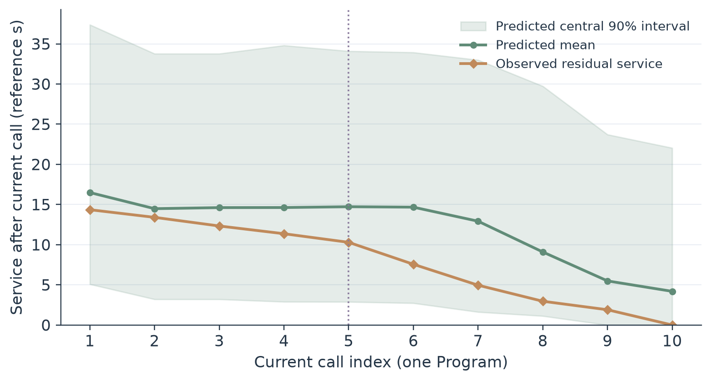

图 8：同一个 Program 在每次当前调用到达时预测本轮之后的服务。绿色为预测均值和中央 90% 区间，赭色为事后真实后续服务，竖虚线标出第 5 次调用。各轮预测只使用当时已到达输入与已完成历史；横轴并不意味着调度器预知最终共 10 轮。后续服务真值随完成推进减少，但预测不被强制单调，末轮到达时也不会提前获知其真实后缀为零。 [PDF](./figures/prediction/program_evolution.pdf)

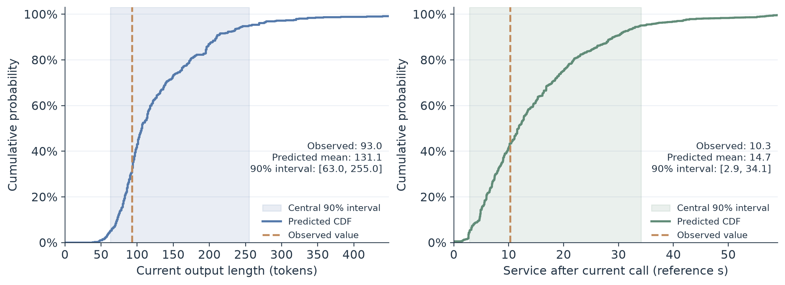

图 9：示例第 5 次调用的预测 CDF。左图当前输出的预测均值为 131.1 token、实际为 93 token，90% 区间为 $[63,255]$；右图后续服务均值为 14.72 reference s、实际为 10.29 reference s，90% 区间为 $[2.88,34.09]$。阴影表示预测中央区间，赭色竖线只表示该状态的一次实际实现。一个状态只有一个观测，无法据此画出其“真实条件分布”；分布质量需结合图 7 的跨状态覆盖和表中的 CRPS 判断。 [PDF](./figures/prediction/call_distribution_example.pdf)

这个例子把指标还原到调用：当前输出均值误差为 38.1 token，后续服务均值误差为 4.43 reference s，两个实际值都落入区间，但区间并不窄。Kairos 因而将森林输出作为有不确定性的推进报价，而不把预测均值当作真实剩余时间或容量合同。这里单独检验了信息层的可用性与局限，端到端是否获益仍由完整控制与执行路径共同决定。

### 2.3.3 程序调度层：统一排序，再用独立容量事务兑现

**由任务推进推导排序指标。** 当前调用若在标准服务量为 $s_i$、后续剩余量为 $R_i^+$ 的 Program 上完成，其近似推进比例为 $s_i/(s_i+R_i^+)$. 对不确定的后缀工作，先对条件分布取期望：

$$
g_i=\mathbb{E}_{R_i^+\sim\widehat P_i^+}\!\left[\frac{s_i}{s_i+R_i^+}\right]
=\sum_jp_{ij}\frac{s_i}{s_i+r_{ij}}.
\tag{5}
$$

再以当前物理代价 $t_i$ 除以预期推进比例：

$$
J_i=\frac{t_i}{g_i},\qquad \pi_{\mathrm{ready}}=\operatorname{sort}_{i\in\mathcal R}(J_i,\mathrm{arrival}_i).
\tag{6}
$$

对 ready 请求，$t_i$ 是基于当前布局的物理报价，可拆为当前恢复/重算代价与预计剩余 decode 代价：

$$
t_i= T_i^{\mathrm{recover/recompute}}(G_i,H_i^{\mathrm{CPU}};\mathrm{profile})
 + d_1\,\max(1,\widehat O_i^{\mathrm{rem}}),
\tag{6a}
$$

其中 $G_i,H_i^{\mathrm{CPU}}$ 分别表示已经确认的 GPU 前缀和 CPU 接续区间，$d_1$ 是独立标定的单序列 decode 步长，$\widehat O_i^{\mathrm{rem}}$ 是根据当前输出分布和已生成 token 条件化后的预计剩余输出量。恢复项由真实当前覆盖与 profile 计算；它不是把预测输出均值换算成 KV 页数。

$J_i$ 越小，代表以较低当前代价获得相对更多的 Program 推进；到达顺序只用于同分稳定打破平局。若 $t_i=s_i$ 且剩余服务为确定值，$J_i=s_i+R_i^+$；若没有后续服务，$g_i=1$，指标退化为当前调用的服务代价。因此，该式保留了短工作优先的直觉，同时显式计入后缀分布的不确定性及当前恢复/执行代价。

这个指标是用于排序的局部指数，不是 Program 完成时间的精确预测，也不对任意自暂停、批处理和容量约束声称最优性。它的价值在于让排序的收益项与当前代价项分开、量纲明确，并对后续服务分布逐原子求期望，而不是先把分布压成均值。

**冷启动与成熟请求共用同一队列。** 所有当前 ready 的请求，包括初轮和已经有完成历史的返轮，都进入同一公式与同一就绪队列。成熟请求可用个体因果森林分布；冷启动请求或个体预测尚未到达时，使用同阶段训练先验。系统不设置“只要有成熟请求，冷请求就不得检查”的类别门控。信息不足会体现在分布来源和置信度上，而不是改变排序规则。

**连续性位置不是第二条执行队列。** 对正在运行但未进入 ready 队列的 Program，系统用同一推进率排序函数计算连续性报价；其中标准工作项来自当前调用的标准服务量，物理代价项则采用按已生成进度条件化后的剩余输出与当前恢复布局报价。该值只参与资源受害者优先级，不改变其已运行状态或 ready 派发顺序。对工具期 idle Program，已保存的后缀分布含其下一轮及后续服务；系统从独立训练样本按已观测阶段和最后已观测 prompt 求一个虚拟下一调用量子 $q_i$，并计算：

$$
a_i=\mathbb{E}[\min(q_i,R_i^+)\mid R_i^+>0],\qquad
b_i=\mathbb{E}[\min(q_i/R_i^+,1)\mid R_i^+>0],\qquad
J_i^{\mathrm{idle}}=\frac{a_i}{b_i}.
\tag{7}
$$

$J_i^{\mathrm{idle}}$ 用来把 idle owner 放到连续性/回收优先级中，不使其取得执行名额。当前设备上，参考量子与物理量子可能不在同一报价尺度；系统用同一训练样本计算两者，并令 $\eta_i=q_i^{\mathrm{phys}}/q_i^{\mathrm{ref}}$，将 idle 报价换算为 $\eta_iJ_i^{\mathrm{idle}}$。就绪队列的 J 不被此 idle 换算改变。

因此，系统维护两个用途不同但共享一套报价的结果：ready J 决定真正可执行请求的先后；ready、running 与 idle 的连续性位置决定资源不足时哪些 optional pin 可以先被撤销。后者影响受害者选择和已有队列的边界，不会把非 ready Program 插入 vLLM 的执行队列。

**调用容量账本。** 排序回答“先检查谁”，并不提前把预测输出均值或 Replay 标签当成内存需求；本方法对未知终止长度的调用按原生执行前沿记账，固定工作量 Replay 也不改变这一点。令 page size 为 $b$、prompt 为 $n_i$、已生成输出为 $g_i^{\mathrm{obs}}$、在途 token 占位为 $p_i^{\mathrm{pend}}$、已计算 token 为 $c_i$、与实际输出标签无关的公开输出上限为 $u_i$，则当前目标页数为：

$$
M_i=\left\lceil\frac{\min\!\left(n_i+u_i,\ \max(n_i+g_i^{\mathrm{obs}}+p_i^{\mathrm{pend}},c_i)+1\right)}{b}\right\rceil.
\tag{8}
$$

$u_i$ 只限制合法终点；实际申请随原生前沿增长，预测的输出均值不进入容量目标。物理页由 vLLM 原生 KV allocator 分配，账本在准入、调用完成、引用清理等边界同步；单纯 decode 增长不触发完整重排。固定 Replay 的目标输出长度只由隔离的执行停止边界消费，不作为公开合同或调度器输入。

**逐项准入与严格 claim。** 令 $r_i$ 为当前已记账页数，$L=C_{\mathrm{GPU}}-32$ 为扣除 32 页原生安全余量后的准入上限。系统沿 ready J 顺序对同一状态快照逐项只读试算，只有通过检查的计划才提交：

1. 若容量和执行名额足够，直接授权当前调用，并记录其真实调用容量合同。
2. 否则，只能考虑连续性次序更低、确属 optional、未运行、未清理且没有 DMA/native 引用义务的 KV pin；从最低优先级一端开始撤销，直到容量满足或候选耗尽。
3. 若某个较高优先级调用因受保护容量不足而等待，记录其所需页数作为 claim。之后的较低优先级调用只能使用不侵蚀该 claim 的剩余容量；不能靠消耗这部分信用绕过等待者。
4. 运行中的调用、DMA 清理中的引用和原生 KV 页都属于锁定状态，不是 victim。调用 grant 与其页账本一并提交；容量不足时不伪造 grant。

claim 是有界准入事务中的容量信用，不是未来时间预测，不承诺具体启动时刻，也不模拟未来调用队列。它只防止一个已受阻的高优先级调用所需容量，在当前快照内被后续低优先级调用继续占用。

**只对原计划 victim 做安全部分保留。** 得到原始准入计划后，Kairos 不重排 grant 集合、不创建额外 victim，也不对所有 pin 预先裁剪。它只在原计划确实要撤销的 victim 中，检查是否能留下安全前缀。设原计划结束后的空闲页为 $F$，未被 claim 占用的空闲预算为 $F-Q$，其中 $Q$ 是该 claim 实际信用；设按原顺序撤销 victim 并提交原 grant 集合时的最小瞬时余量为 $H$。可用于部分保留的预算为：

$$
U=\min\!\left(\max(0,F-Q),H\right).
\tag{9}
$$

只把 $U$ 分配给原计划中未获 grant 的 victim，并以连续性优先级从高到低尝试保留。ready owner 的保留上限由当前已到达请求与 native block hash 的公共前缀证明；idle owner 不猜未来输入，只能依靠实际可安全释放的私有后缀。保留必须是前缀，释放必须是其后缀；共享页、非私有页、运行态页、native 引用或 DMA 清理不满足条件时，回退为完整撤销或按父计划失败关闭。

这个步骤只减少“超出当前准入所需”的过度回收，不改变原来哪些请求获得 grant、claim 有多少信用或任一提交时刻的容量上限。保留多少仍受完整事务每一步余量限制，不能只以最终总页数判断安全性。

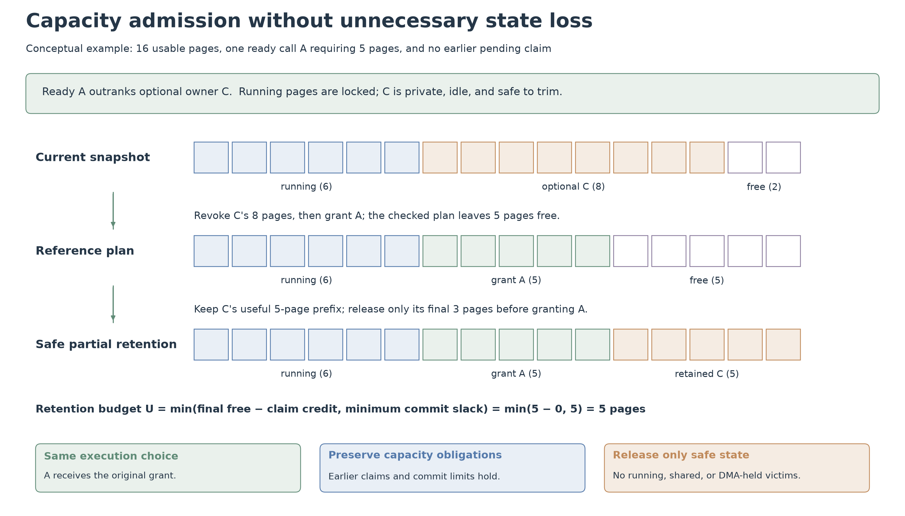

图 10：容量事务的示意例子，不是性能测量。可用预算已扣除安全余量，共 16 页；6 页锁定在运行态，低优先级 owner C 的 8 页可安全撤销，另有 2 页空闲。高优先级 A 需要 5 页，参考计划完整撤销 C 后可准入 A，留下 5 页余量。若这 5 页也满足最小提交余量、没有更早 claim 占用且 C 可以安全保留前缀，则实际只释放 C 的末尾 3 页。两个步骤属于同一次事务的计划与落实；准入 A 的选择、优先级和容量义务保持不变。实际页池不要求这些页在物理地址上连续。 [PDF](./figures/method/admission_retention.pdf) · [可编辑 PPTX，幻灯片 2](./figures/method/Kairos_Method_Figures.pptx)

### 2.3.4 KV 连续性管理层：用可观测收益与当前机会成本选 TTL

一个调用完成后，Program 可能进入工具等待。此时系统可在 GPU 上保留其一段历史 KV，也可撤销该 optional pin，让出 HBM。该选择发生在调用完成之后；已经观测到的调用输出和布局可以用于定价，但它们不会提前泄漏到该调用的调度决策。

**保留收益。** 对可复用的已提交块，根据当前 HBM 前缀、CPU 已驻留块和独立设备服务 profile，估计保留与撤销后的恢复成本。只对撤销后确实失去的唯一页计入边际影响：

$$
B_i=\max\!\left(0,\ T_i^{\mathrm{restore}}(\mathrm{release})-T_i^{\mathrm{restore}}(\mathrm{keep})\right).
\tag{10}
$$

恢复报价将 GPU 连续前缀、CPU 可接续区间和其后需要重算的工作作为一个布局整体计算，避免把每页成本简单相加。共享或仍被其他 owner 覆盖的页，不被误计为撤销后必然丢失的收益。

**当前容量压力。** 仅比较“保留该 owner 当前唯一可释放页”与“释放这些页”两种当前状态。两次扫描复用相同的 ready 顺序、容量、执行槽、optional victim 集、claim 和受害者规则；扫描输出中新增的可准入 Program 记为 $A$，被挤出的 Program 记为 $D$。定义一个有界压力率：

$$
\rho_i=\min\!\left(1,\frac{\max(0,|A|-|D|)}{\max(1,\min(|\mathcal R|,S-|\mathcal O|))}\right),
\tag{11}
$$

其中 $A$ 是“释放 owner 唯一可回收页”扫描相对“保留”扫描新增可准入的 Program 集，$D$ 是释放扫描相对保留扫描失去的已选中 Program 集；$\mathcal R$ 是当前未 grant 的就绪调用，$S$ 是最大并发执行名额，$\mathcal O$ 是已占用名额。这个量只近似“现在释放是否能净推进一个等待调用”，不是精确的 JCT 收益；它没有展开未来队列，也不把一次排序或容量扫描伪装成完整反事实模拟。

**有限期限。** 对工具类别 $z$，从其已完成返回间隔样本构造经验分布 $D_z$。对候选保护时长 $\tau$，返回概率与预期持有时间分别为：

$$
P_z(\tau)=\Pr(D_z\le\tau),\qquad
H_z(\tau)=\mathbb{E}[\min(D_z,\tau)].
\tag{12}
$$

在零时长和经验支持内的返回边界上搜索，选择：

$$
\tau_i^*=\arg\max_{\tau}\left[P_z(\tau)B_i-\rho_iH_z(\tau)\right].
\tag{13}
$$

零保护时长的效用为零，因此非正收益不会换来无条件长期 pin。保护到期后，如果 Program 尚未返回且没有其他合法引用，缓存引用可被撤销；若 Program 已返回，则返回请求仍按当前统一 ready J 竞争，容量不足时其 optional 缓存仍可参与受害者规则。TTL 约束的是工具期可撤销保护，不是对返轮的永久执行优先权。

该经济式用实际布局估计“保留能少付多少恢复代价”，用成对准入扫描估计“当前占用是否真的挡住了别人”，再用经验返回分布控制“收益可能何时实现、资源可能占用多久”。它是一种低成本局部近似，不宣称等于全局最优的 program 完成时间差。

### 2.3.5 跨层恢复执行层：围绕联合可恢复前缀管理布局

**HBM 页与引用生命周期。** GPU KV 仍由 vLLM 原生页池和引用计数管理。Kairos 的容量账本控制 grant 和 optional pin，不越过 native allocator 直接制造或提前释放物理页。一个页只有在所有 native、共享和 DMA 引用退休后才真正可复用；因此逻辑 revoke、异步传输完成和物理 free 是不同事件。准入扫描将运行态、DMA 清理态与仍有 native 引用的页锁定，引用确认后才更新账本。

**CPU 副本与联合恢复端点。** CPU KV 由 LMCache 以完整 chunk 管理，当前路径按 256-token chunk 形成历史覆盖清单。对 Program $i$，记 GPU 已确认覆盖的连续前缀长度为 $G_i$ 个 chunk，CPU 中实际驻留的 chunk 索引集合为 $C_i$。联合恢复端点定义为：

$$
E_i = G_i + \max_{\ell \in \mathbb{Z}_{\ge 0}} \ell \quad \text{s.t.} \quad \forall q \in \mathbb{Z},\ 0 \le q < \ell \implies G_i+q \in C_i.
\tag{14}
$$

因此，端点从 GPU 连续前缀开始，沿 CPU 中连续存在的 chunk 向后延伸；单独存在的后缀 CPU chunk，若前面的历史有缺口，并不自动构成可接续恢复区间。

CPU 写入或空间回收以所有活跃 owner 的联合端点为约束。压力写入优先保存仍缺少 GPU 覆盖的互补历史，并保留必要的边界备份；额外的重复副本只在现有空闲 CPU 槽允许时接纳。CPU 淘汰逐个考虑真实驻留对象，若删除会缩短任一活跃 Program 的联合恢复端点，则不将其作为零损失 victim。已完成或不再有活跃 owner 的数据可按现有生命周期释放。

**恢复报价与执行。** 排序与 TTL 报价读取当前已确认的 GPU 页、CPU chunk 和缓存命中信息。可恢复的 HBM/CPU 前缀减少重算；CPU 缺口之后的内容则按当前标定成本比较回载与重算。执行侧仍由原生 vLLM 调度、页分配和 LMCache 传输完成；Kairos 不把未来的缓存布局当作已经存在，也不以预测输出长度提前分配全部输出 KV。真实分配、回迁和请求完成事件随后更新布局证据与历史。

这使缓存管理围绕“请求此刻能从哪里继续”展开：GPU 页带来低延迟命中，CPU 副本保留跨轮历史，安全撤销释放当前容量，而连续性检查防止为局部空间收益破坏其他 Program 的恢复路径。

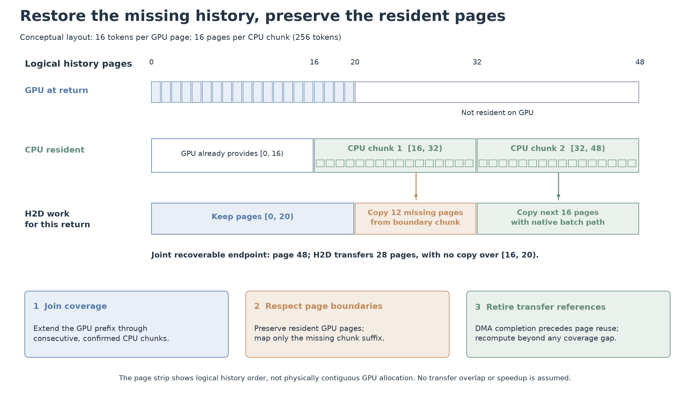

图 11：联合恢复与页边界传输示意，不包含后端性能数据。每个 GPU 页 16 token、CPU chunk 256 token。GPU 已覆盖逻辑页 $[0,20)$，CPU 具有 $[16,32)$ 与 $[32,48)$ 两个完整 chunk；二者联合可恢复至第 48 页。返回时保留 GPU 原有页，只搬运边界 chunk 中缺少的 12 页，再由原生批量路径搬运下一 chunk 的 16 页。逻辑上的 28 页传输量来自示意布局，不是实测带宽或加速比；DMA 引用退休前，相关页仍不能被回收复用。 [PDF](./figures/method/joint_restoration.pdf) · [可编辑 PPTX，幻灯片 3](./figures/method/Kairos_Method_Figures.pptx)

### 2.3.6 在线流程与实验结果

每次新调用到达、调用完成、容量释放或引用清理等会改变决策条件的边界，Kairos 执行一次控制快照；它不因单个 decode token 增长就重新运行整套排序。该快照可以概括为：

~~~text
On a decision-relevant event:
  1. Read arrived prompts, completed outputs, observed services and actual KV/CPU residency.
  2. Obtain current-output and post-current residual-service distributions;
     use the causal stage prior if an individual forest result is not ready.
  3. Compute J for every ready call; sort one ready queue by increasing J.
  4. Add running/idle continuity positions for optional-victim ordering only.
  5. In ready order, check execution slots and the native-frontier page contract.
     Revoke only lower-priority eligible optional pins if necessary;
     preserve an earlier capacity claim from consumption by later candidates.
  6. Among the original victims only, retain safe prefixes within the plan's
     worst intermediate free-page budget; commit the checked releases/grants in order.
  7. On call completion, update observed history, estimate keep-vs-release
     recovery benefit and paired-scan capacity pressure, then choose a finite TTL.
  8. Let native vLLM/LMCache operations update physical references and the
     jointly recoverable GPU/CPU history; feed only completed events forward.
~~~

**九组端到端回放。** 下表汇总同一批 SWE Program 在三种首次到达模式下，对原生 vLLM+LMCache、Continuum 与 Kairos 的单次顺向运行。平均/P95 JCT 均按 Program 计算；TTFT 和 Makespan 为秒。九组均完成 178/178 次调用，失败为零，逐组审计通过。

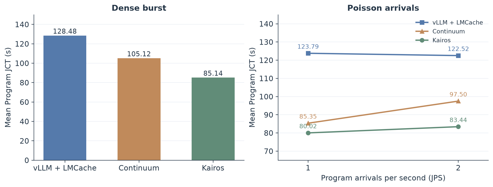

图 12：九组端到端回放的平均 Program JCT。Dense 使用柱状图，Poisson 用 JPS=1 与 JPS=2 的折线连接同一方法；图中只比较同一指标的均值，P95 等尾部指标仍见下表。每个方法/负载组合仅有一次顺向运行，图示为观察结果而非统计显著性结论。 [PDF](./figures/evaluation/mean_jct.pdf)

| 到达模式 | 方法 | 平均 JCT | P95 JCT | Makespan | 平均 TTFT | P95 TTFT | 成功调用 |
|---|---|---:|---:|---:|---:|---:|---:|
| Dense burst | vLLM+LMCache 原生 | 128.48 | 161.65 | 164.74 | 6.12 | 14.14 | 178/178 |
| Dense burst | Continuum | 105.12 | 154.77 | 159.47 | 5.07 | 27.34 | 178/178 |
| Dense burst | Kairos | **85.14** | **138.02** | **147.45** | **3.23** | **7.64** | 178/178 |
| Poisson，JPS=1 | vLLM+LMCache 原生 | 123.79 | 158.75 | 175.81 | 5.63 | 13.84 | 178/178 |
| Poisson，JPS=1 | Continuum | 85.35 | 134.49 | 158.68 | 3.34 | 18.98 | 178/178 |
| Poisson，JPS=1 | Kairos | **80.02** | **130.51** | **146.15** | **2.83** | **7.94** | 178/178 |
| Poisson，JPS=2 | vLLM+LMCache 原生 | 122.52 | 157.15 | 165.16 | 5.66 | 11.93 | 178/178 |
| Poisson，JPS=2 | Continuum | 97.50 | **141.34** | 162.97 | 4.34 | 22.51 | 178/178 |
| Poisson，JPS=2 | Kairos | **83.44** | 141.57 | **149.41** | **3.08** | **10.86** | 178/178 |

**Kairos 相对对照的变化。** 负值表示 Kairos 指标更低；正值表示更高。

| 到达模式 | 对照 | 平均 JCT | P95 JCT | Makespan | 平均 TTFT | P95 TTFT |
|---|---|---:|---:|---:|---:|---:|
| Dense burst | vLLM+LMCache 原生 | -33.73% | -14.62% | -10.49% | -47.28% | -46.01% |
| Dense burst | Continuum | -19.01% | -10.82% | -7.54% | -36.26% | -72.07% |
| Poisson，JPS=1 | vLLM+LMCache 原生 | -35.36% | -17.79% | -16.87% | -49.68% | -42.61% |
| Poisson，JPS=1 | Continuum | -6.25% | -2.96% | -7.89% | -15.13% | -58.17% |
| Poisson，JPS=2 | vLLM+LMCache 原生 | -31.90% | -9.91% | -9.54% | -45.48% | -8.99% |
| Poisson，JPS=2 | Continuum | -14.42% | **+0.16%** | -8.32% | -28.95% | -51.75% |

Dense burst 中，Kairos 的平均与 P95 JCT 均低于两种对照。Poisson JPS=1 也呈现相同方向。Poisson JPS=2 下，Kairos 平均 JCT 与 Makespan 低于 Continuum，但 P95 JCT 高 0.16%，因此不能称为尾部全面领先。每个 workload-arm 仅运行一次；这些数值是本轮观察，不是统计显著性结论，也不能单独证明某个机制造成全部收益。

**实验配置与协议。** 使用优云1单张 RTX 4090 24 GiB、Qwen/Qwen3-8B BF16、GPU KV 5,935,988,736 bytes、CPU KV 10 GiB、最大并发序列 8、最大上下文 16,384、每步 batch token 预算 2,048、page size 16。运行时为 PyTorch 2.13.0+cu132、vLLM 0.28.0、LMCache 0.5.5rc4、Transformers 5.16.1、NumPy 2.2.6。

三种到达模式复用同一组 16 个 SWE Program、178 次调用和 26,164 个目标输出 token。Dense 使用冻结的 dense_return_burst_production_v1 trace；Poisson 两组改变首次 Program 到达过程，JPS 分别为 1 和 2、seed 为 20261028，之后由回放事件闭环推进。各组均为固定工作量 Replay：真实当前/未来输出长度、未来消息、未来工具类别与耗时、最终轮标记均不向调度器开放；公开输出上限 16,384 与真值标签无关。真实长度仅在隔离的 Replay 执行停止边界使用，并在调用完成后作为已观测历史。预测真值输入与 oracle 排序均未使用。

三种方法均按 Native → Continuum → Kairos 的顺序各运行一次，不因观察到的结果择优重跑。Native 使用上游同步路径，研究方法采用异步调度路径；因此这是集成系统的端到端对比，并非只替换排序公式的单变量消融。Dense 和 Poisson 共用同一张 RTX 4090（UUID GPU-50eaf613-66a6-4f10-ff7c-54a99c5abadb）、运行时 ABI、计算标定 SHA-256 c778351305463befca77bbfa3948507b448e9e218fe4ad32e33d5e8287ed3409 和回迁标定 SHA-256 c977b632fd1ea967560fea64a69a1eeaa0a5a6fa6c34840bd9dd63abcbd87500。九组完整原始归档 SHA-256 为 5eee66d71e7ee9aa3c9c12a05796637cae0dd47a5785ac874a50d55a3b87b8f8；每组逐项审计均验证 workload、profile、容量、GPU 身份与回放工作签名一致。实验明细、逐组审计和归档随本项目实验记录保存；以上哈希可用于核对归档完整性。

### 2.3.7 实现组织与可复核边界

Kairos 的公开实现按决策职责组织。完整调度入口为 `kairos/scheduler.py`，其组合的各层分别对应观测快照、资源报价、容量事务、连续性保护与原生执行接口；方法本身不需要选择内部实验分支。信息层、控制层与执行停止边界通过明确的数据接口衔接。

| 方法环节 | 主要实现位置 | 决策或观测边界 |
|---|---|---|
| 当前输出与后缀服务预测 | `kairos/prediction/` | 已到达 prompt、已完成输出和累计已观测服务 |
| 统一 J 排序与连续性位置 | `kairos/scheduling/snapshot.py`、`priority.py`、`score.py` | 同一控制快照中的 ready、running 与 idle 状态 |
| 容量 claim、grant 与安全部分撤销 | `kairos/scheduling/admission.py`、`retention.py` | 原生前沿、真实引用、执行名额及逐步提交余量 |
| 经济 TTL | `kairos/continuity/holding.py`、`economics.py` | 本轮完成后的恢复收益、当前竞争和已观测返回样本 |
| 联合覆盖与恢复传输 | `kairos/backend/`、`kairos/_runtime/` | 已确认 GPU/CPU 覆盖、原生引用及 DMA 完成事件 |
| 固定工作量回放与完成后更新 | `kairos/replay/` | 私有执行停止消费长度标签，成功完成后发布当前动作观测 |

仓库中的 CPU 检查重放冻结的数值与容量事务案例，并覆盖部分撤销、claim 信用、异步引用安全以及按字节模拟的恢复路径。它们用于检验代码组织变化是否保持决策与信息边界；整理后入口的 GPU 性能仍需由真实服务器回放确认。九组实验的逐 Program JCT 与逐请求指标保存在 `results/benchmark/`，`python -m kairos.audit` 可重新核对完成工作量及平均 JCT；源代码入口和运行命令见仓库 README。

文档图表的离线指标、模型哈希、数据来源与示例选择规则保存在 [figures/data/](./figures/data/)，可用 `scripts/build_figures.py` 在本地 CPU 重算。工作负载快照只保留匿名聚合统计；预测数据与图表只对应当前发布模型。三张结构示意图以原生可编辑形状保存在 [PowerPoint](./figures/method/Kairos_Method_Figures.pptx)，并与 PDF、PNG、SVG 共用布局生成。配色与图形组织参考 CONTINUUM 的模块分组、等待长尾和到达率曲线，以及 CacheBlend 的缓存布局示意；具体参考位置见 [sources.json](./figures/data/sources.json)。

### 2.3.8 候选扩展（未合并）：Quantile-J 排序

> **状态：额外候选，未合并。** 默认 Kairos 仍使用现有 `honest_cdf` 森林、均值 J 排序、容量事务与 KV 保护策略；本节只记录一个离线候选，不改变默认配置、入口、实验结果或任何代码路径。没有把 QJ 接入 `score.py`、`priority.py` 或 `scheduler.py`。

**动机与定义。** 当前 J 用预测分布的均值 progress：

\[
J_i=\frac{t_i}{E[s_i/(s_i+R_i^+)]}.
\]

QJ 不改森林、不改每个样本上的 J 定义，只把排序统计量从均值换成分位。对后缀分布 \(\widehat P_i^+\) 取 q 分位 \(Q_q(R_i)\)，令

\[
\widehat J_i^{(q)}
=
\frac{t_i}{s_i/(s_i+Q_q(R_i))}
=
t_i\left(1+\frac{Q_q(R_i)}{s_i}\right).
\tag{13}
\]

由于 \(J_i(R)\) 对 \(R\) 单调递增，分位与 J 可交换：\(Q_q(J_i)=J_i(Q_q(R_i))\)。因此不需要采样：直接在已有的离散 atoms/mass 上做加权分位，再按 \(\widehat J_i^{(q)}\) 升序排序即可。q 越小越“乐观”，越接近“谁有机会更早完成”；q 越大越接近中位数/均值。

**同一示例。** 图 13 仍是图 9 的 `psf__requests-1766` 第 5 次调用。预测均值 14.72 s，观测 10.29 s，90% 区间 [2.88, 34.09] s；q=0.05 为 2.86 s，q=0.12 为 4.79 s。分布右侧延伸到 64.0 s，39.1% 的概率质量在均值右侧；均值被长尾拉高，而 QJ 的两个分位落在下尾。QJ 的分位不是 J 的点估计：示例中 q=0.05 的 2.86 s 远低于真值 10.29 s，它只用于排序，不用于容量、claim 或成本估值。

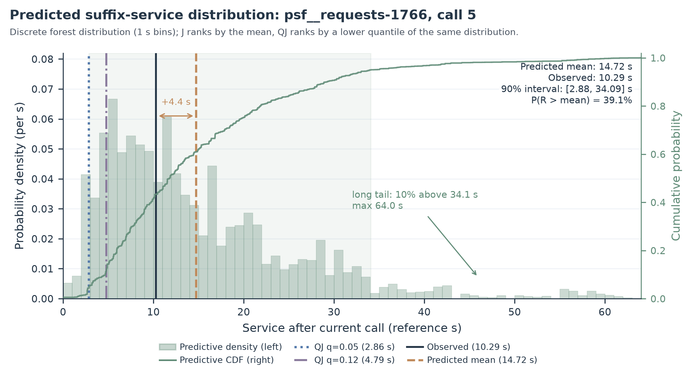

**图 13：同一后缀分布的概率密度、CDF、均值、观测值与 QJ 分位。** 柱为 1 s 分箱的概率密度；绿色阶梯线为同一分布的 CDF（右轴）；阴影为 90% 区间；黑线为观测值，橙虚线为预测均值，蓝点线和紫点划线分别为 q=0.05 与 q=0.12。图中同时给出“均值比观测高 4.4 s”和右侧长尾的标注。 [PDF](./figures/prediction/qj_example_distribution.pdf)

**q 的甜区。** 图 14 是在 E10-BU 的 Dense、Poisson JPS=1、Poisson JPS=2 三组共 1064 次“至少两个成熟候选”的扫描上做的 q 扫描。q=0.05 的 Top-1 最高（38.9%），q=0.12 的 Top-3/Top-5 最高（81.9%/97.7%）；q=0.5 退化为中位数排序，Top-1 仅 27.4%。q 太小（如 0.02）只取到极端下尾原子，概率质量不足、容易变成“彩票”；q 太大则把上尾重新纳入，下尾排序信号被均值/中位数淹没。

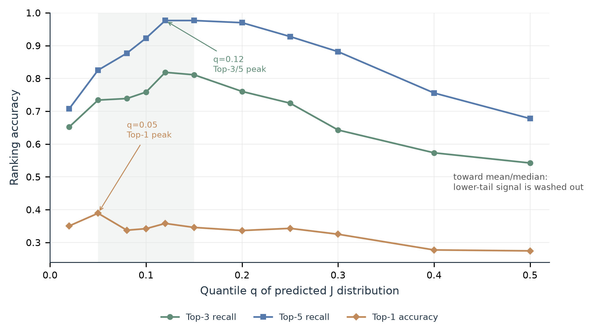

**图 14：QJ 的 q 扫描。** 横轴为 J 分布的分位 q，纵轴为 Top-1/Top-3/Top-5 排序准确率；阴影标出 0.05–0.15 的候选区间。q=0.05 偏 Top-1，q=0.12 偏 Top-3/Top-5，q→0.5 明显退化。 [PDF](./figures/prediction/qj_q_curve.pdf)

| q | Top-1 | Top-3 recall | Top-5 recall |
|---:|---:|---:|---:|
| 0.02 | 35.1% | 65.2% | 70.8% |
| **0.05** | **38.9%** | 73.4% | 82.5% |
| 0.08 | 33.7% | 73.9% | 87.7% |
| 0.10 | 34.2% | 75.9% | 92.3% |
| **0.12** | 35.8% | **81.9%** | **97.7%** |
| 0.15 | 34.6% | 81.1% | 97.7% |
| 0.20 | 33.6% | 76.0% | 97.0% |
| 0.30 | 32.5% | 64.3% | 88.2% |
| 0.50 | 27.4% | 54.2% | 67.8% |

**端到端扫描上的排序质量。** 真实 J 采用事后观测的当前与后续服务量 \(J_i^\star=s_i^{\mathrm{obs}}+R_i^{\mathrm{obs}}\)（未把 restore 加回；加回后结论基本不变）。下表在 1064 次扫描上比较当前均值 J、QJ q=0.05 与 q=0.12；所有指标都是离线排序诊断，不是反事实 JCT。

| 排序统计量 | Top-1 | Top-3 recall | Top-5 recall | Top-3 集合 | Kendall τ | Weighted inversion | Regret 中位 |
|---|---:|---:|---:|---:|---:|---:|---:|
| 当前均值 J | 32.4% | 64.4% | 77.9% | 63.3% | 0.286 | 31.9% | 41.8% |
| **QJ q=0.05** | **38.9%** | 73.4% | 82.5% | 68.5% | 0.331 | 26.6% | **30.6%** |
| **QJ q=0.12** | 35.8% | **81.9%** | **97.7%** | **69.0%** | **0.415** | **20.8%** | 40.6% |

在 791 个“所有候选都有后缀分布”的扫描上，提升更明显：当前 J 为 Top-1 35.1%、Top-3 66.9%、Top-5 83.1%；q=0.05 为 42.7%/78.0%/87.7%；q=0.12 为 39.6%/88.0%/99.5%。381 个缺少分布的候选在 QJ 中回退到点 J，因此全量 1064 次扫描的结果比完整分布子集更保守。

**分 workload。** 三种到达模式的 Top-1 与 Top-3 recall：

| 负载 | J Top-1 | QJ q=.05 Top-1 | QJ q=.12 Top-1 | J Top-3R | QJ q=.05 Top-3R | QJ q=.12 Top-3R |
|---|---:|---:|---:|---:|---:|---:|
| Dense | 33.7% | **36.7%** | 35.6% | 60.6% | **82.9%** | 82.6% |
| Poisson JPS=1 | 28.0% | **32.9%** | 28.7% | 61.3% | 65.5% | **73.8%** |
| Poisson JPS=2 | 35.1% | **46.5%** | 42.4% | 70.9% | 70.9% | **88.3%** |

Poisson JPS=1 上 q=0.12 的 Top-1 没有提升，但 Top-3 从 61.3% 到 73.8%；q=0.05 的 Top-1 更稳。Poisson JPS=2 上 q=0.05 的 Top-1 达到 46.5%。因此不能写成“QJ 在所有负载、所有头部指标上全面领先”，只能写成“下尾分位在多数负载上改善 shortlist，q=0.05 对 Top-1/regret 更稳”。

**配对 bootstrap。** 以扫描为单位对 QJ 与当前 J 做配对重采样（10,000 次，非独立运行）：

| 对比 | Top-1 差值 | 95% CI | Top-3 recall 差值 | 95% CI | Regret 差值 | 95% CI |
|---|---:|---:|---:|---:|---:|---:|
| q=0.05 − J | +6.48pp | [4.23, 8.74] | +9.02pp | [7.24, 10.90] | −0.212 | [−0.284, −0.143] |
| q=0.12 − J | +3.38pp | [1.79, 4.89] | +17.48pp | [15.23, 19.83] | −0.086 | [−0.129, −0.046] |

这些区间只描述同一批 1064 次扫描内的不确定性，不是跨独立服务器运行的显著性结论。

**未合并边界与后续条件。** QJ 目前只是候选：

- **默认路径不变。** 当前 `honest_cdf` 森林、均值 J、容量事务和 KV 保护仍是默认；本节没有新增运行入口，也没有改任何默认分数。
- **不是点估计。** QJ 的 q 分位只用于排序，不用于 J 的数值、容量页数或 claim 估计；点估计仍使用均值、中位数或 trim 均值。
- **oracle 口径。** 真实 J 是事后观测的 \(s^{\mathrm{obs}}+R^{\mathrm{obs}}\)，不是反事实 replay；不同排序会改变后续服务与排队，因此这些数字不能直接当作 JCT 收益。
- **q 的选取。** q=0.05 与 q=0.12 是在同一批扫描上扫描得到的，不是独立验证的最优值；0.05–0.15 区间方向一致，但合并前应在未参与选择的 workload 上复核。
- **合并条件。** 若未来接入，建议以配置项形式提供 `rank_quantile`，默认关闭；先在 Dense、Poisson JPS=1/2 上做与当前 J 的 A/B 回放，比较 JCT、TTFT、P95 与排序 regret，再决定是否改变默认。一个自然的候选配置是：q=0.05 用于“选一个”，q=0.12 用于 shortlist/多候选准入。

### 2.3.9 补充观察（不改正文）：pin 复用、重算与 Continuum 对比

> **状态：补充观察，不改变正文方法、默认配置或已有结论。** 本节只整理同一批 E10-BU 日志上的 pin 与重算统计；两个对照都使用 pin，因此不是 “pin vs no-pin” 的因果消融。

**统计口径。** 同一 16 个 SWE Program、178 calls，Dense、Poisson JPS=1、Poisson JPS=2 各一次。pin 复用指 pin 最终以 `handover_after_allocation` 结束；pin 占用按 references 页数乘实际存活时间估计；重算比例从 `admit` 的 `prompt_tokens - local_cached_tokens - external_cached_tokens` 计算，是前缀缓存口径的近似，不是 GPU FLOPs 实测。两边使用同一 workload、同一 4090D、同一模型和同一信息边界。

| workload | 方法 | pin 数 | 复用 | 复用率 | TTL 中位 | TTL=0 | 平均 pin 页数 | 占容量 | 复用 pin 的 reload 估算 |
|---|---|---:|---:|---:|---:|---:|---:|---:|---:|
| Dense | **E10-BU** | 140 | 80 | **57.1%** | 0.482 s | 24/164 | 134 页 | **5.39%** | **7.51 s** |
| Dense | Continuum | 146 | 118 | **80.8%** | 0.482 s | 18/164 | 393 页 | **15.81%** | 4.80 s |
| P1 | **E10-BU** | 129 | 77 | **59.7%** | 0.498 s | 35/164 | 116 页 | **4.67%** | **7.60 s** |
| P1 | Continuum | 149 | 110 | **73.8%** | 0.438 s | 15/164 | 145 页 | **5.84%** | 4.41 s |
| P2 | **E10-BU** | 130 | 75 | **57.7%** | 0.482 s | 34/164 | 115 页 | **4.62%** | **8.41 s** |
| P2 | Continuum | 155 | 120 | **77.4%** | 0.444 s | 9/164 | 242 页 | **9.74%** | 4.80 s |

**重算比例。** 两边 prompt token 总量相同（977,073），admit 数相同（188），因此比例可直接比较：

| workload | E10-BU 缓存命中 / 重算 | Continuum 缓存命中 / 重算 | 重算 token 差 | 相对差 |
|---|---:|---:|---:|---:|
| Dense | **79.08% / 20.92%** | 77.27% / 22.73% | +17,685 | +8.7% |
| Poisson JPS=1 | **79.94% / 20.06%** | 78.23% / 21.77% | +16,708 | +8.5% |
| Poisson JPS=2 | **78.60% / 21.40%** | 76.25% / 23.75% | +22,961 | +11.0% |

**JCT 对照。** Dense 85.14 对 105.12，Poisson JPS=1 为 80.02 对 85.35，Poisson JPS=2 为 83.44 对 97.50（E10-BU 对 Continuum）。

**结论。**

- **E10-BU 没有大幅增加重算。** 三组重算比例都更低，少 1.8–2.4 个百分点，约 1.7 万–2.3 万 prompt token，相对少 8.5%–11.0%。
- **E10-BU 的 pin 复用率更低**（57%–60% 对 74%–81%），**pin 占用也更低**（4.6%–5.4% 对 5.8%–15.8%），但 JCT 更低。
- 因此当前相对 Continuum 的收益不能归因于 “pin 得更多/复用得更多”；更像是更选择性的 pin、更低的容量占用，以及调度/容量事务和恢复路径共同作用。
- pin 仍然有作用：约六成 pin 被复用，复用 pin 的 reload 估算为 7.5–8.4 s；但 pin 不是 JCT 的主要解释变量。
- 这是单次运行、同一批 Program 的观察，不是统计显著性结论；两个方法都 pin，不能据此给出 “no-pin 会慢多少” 的因果数字。

### 2.3.10 补充说明：GPU 回收的联合覆盖判定，而不是简单 LRU

> **状态：补充说明，不替代 2.3.5 原文。** 2.3.5 给出联合可恢复端点、页/引用生命周期和恢复报价；这里补的是**回收时到底怎么判断一个 GPU 页能不能撤**。

**核心不是“重复存储”，而是“覆盖”。** 对每个活跃 Program，系统同时看两份覆盖：

- GPU 上连续驻留的块前缀：`gpu_end`；
- CPU 上实际驻留的 256-token chunk 集合：`cpu_chunks`。

联合恢复端点定义为：

$$
E(gpu\_end,C)
=
\max\left(gpu\_end,\ 16\cdot
\max\left\{k \;\middle|\;
\left\lfloor gpu\_end/16\right\rfloor,\ldots,k-1 \in C
\right\}\right).
$$

也就是说：

> 从 GPU 的连续前缀开始，沿着 CPU 中**连续存在**的 chunk 往后接；接得越远，未来能复用的前缀越长。

**GPU 回收时逐个候选页做“撤掉它会不会缩短端点”的判定。** 对每个可回收的 GPU 页：

1. 假设撤掉它，得到新的 `gpu_end'`；
2. 对每个活跃 Program 重新计算 `E(gpu_end', C)`；
3. 如果没有任何活跃 Program 的端点缩短，这个页就是 **zero-loss victim**；
4. 如果所有候选都安全，直接撤；否则选择让端点损失最小的页，再按恢复代价/权重和 recency 打破平局。

实现上的名字是：

- `restore_end()`：计算联合端点；
- `native_zero_restore_loss()`：检查撤掉一组页是否不缩短任何活跃端点；
- `choose_gpu_victims(mode="joint")`：按联合端点损失选 GPU victim；
- `mode="duplicate"` 只是“优先撤 CPU 已覆盖页”的退化模式，不是主机制。

**为什么这才叫联合布局。** 一个 GPU 页是否可撤，不取决于它自己是不是“重复”，而取决于：

```text
撤掉它之后，GPU 前缀 + CPU 连续 chunk 还能接多长
```

例如图 11 的布局：

```text
GPU: [0, 20)
CPU: chunk [16, 32), chunk [32, 48)
联合端点: 48
```

- 撤掉 GPU 的 [16,20) 这几页：CPU chunk [16,32) 仍然覆盖，端点仍是 48，属于零损失；
- 撤掉 GPU 的 page 15：GPU 端点变成 15，而 CPU 没有 [0,16) 的连续前缀，联合端点会掉到 15，不能当零损失；
- 撤掉 GPU 的 [20,48) 本来就不在 GPU，不存在。

所以 victim 选择会**优先撤 CPU 已经能接上的页，保留 GPU 中真正的桥接页**；不是简单 LRU，也不是“看到重复就删”。

**CPU 写入也要按覆盖预算，而不是把所有 GPU 页都复制到 CPU。** `CoverageHistory.write_budget()` 在 CPU 槽不足时：

- `essential`：某个 owner 的 GPU 覆盖不到、CPU 必须保留的 chunk；
- `duplicate`：所有 owner 的 GPU 都已经覆盖的 chunk，只是冗余副本；
- 优先保留 essential，并给每个 Program 留一个 bridge chunk；
- 只有在 CPU 空闲槽允许时，才接纳 duplicate/extra。

这避免把 CPU 塞满“GPU 已经有的副本”，同时不破坏联合端点。

**CPU 回收同样按端点做。** `CoverageHistory.select()` 在 zero-loss 模式下删除 CPU chunk 前，会检查删除后是否缩短任一活跃 Program 的联合端点；会缩短的 chunk 不删。这样 CPU 侧也不会为了局部空间收益，破坏其他 Program 的恢复路径。

**与 2.3.5 的关系。** 2.3.5 的公式和图 11 说明“端点怎么算、H2D 怎么只搬缺口”；本节补的是“端点怎么参与 GPU victim 选择和 CPU 写入/回收”。两者合起来才是完整的联合恢复闭环：

```text
GPU 回收候选
→ 用 CPU chunk 覆盖判断端点损失
→ 选 zero-loss / 最小损失 victim
→ CPU 写入只保留 essential + bridge
→ 返回时按联合端点搬缺口
```

**仍然没有展开的。** 原生 allocator 内部的最终页选择、CPU chunk 的具体替换顺序、传输失败/回退状态机、传输与计算重叠、跨 GPU/多副本布局，仍属于实现与实验边界；但“GPU 回收要看 CPU 覆盖、按联合端点选 victim”这个核心机制，2.3.10 已经补上。

## 参考文献

[1] Luo et al. *Autellix: An Efficient Serving Engine for LLM Agents as General Programs*. https://arxiv.org/abs/2502.13965

[2] Li et al. *Continuum: Efficient and Robust Multi-Turn LLM Agent Scheduling with KV Cache Time-to-Live*. https://arxiv.org/abs/2511.02230

[3] *MARS: Efficient, Adaptive Co-Scheduling for Heterogeneous Agentic Systems*. https://arxiv.org/abs/2604.26963

[4] *Idleness is Relative: Exploiting Tool-Call Idle Windows for Offloading in Agentic Systems with MORI*. https://arxiv.org/abs/2606.00866

[5] Shi et al. *Multi-Segment Attention: Enabling Efficient KV-Cache Management for Faster Large Language Model Serving*. https://arxiv.org/abs/2606.02964

[6] Zheng et al. *Scheduling LLM Inference with Uncertainty-Aware Output Length Predictions*. ICML 2026. https://proceedings.mlr.press/v306/zheng26ae.html

[7] Li et al. *Beyond Prediction: Tail-Aware Scheduling for LLM Inference*. ICML 2026. https://yl3469.github.io/uniboost-icml26/
